<p align="center">
  
</p>

<p align="center">
  <strong>Your tech stack, on an overhead panel</strong>
</p>

<p align="center">
  <a href="https://nodejs.org/">
    
  </a>
  <a href="https://opensource.org/licenses/MIT">
    
  </a>
  
</p>

<h1>Systems Console</h1>

<p>Systems Console is a GitHub Action that turns the platforms and tools you work with into an aircraft overhead electrical panel. Each system is a backlit push-button with its icon and status lamp, wired to a live bus, one panel per group. Add a languages panel and it reads your own repos, so the languages you actually ship show their repo count and the ones you don't sit on standby.</p>

<p>The output is a single animated SVG with no JavaScript, so it plays inside a plain <code>&lt;img&gt;</code> tag on your GitHub profile README. It uses the same phosphor-green palette as its sister projects <a href="https://github.com/maxhayim/flight-path-radar">Flight Path Radar</a> and <a href="https://github.com/maxhayim/cockpit-telemetry">Cockpit Telemetry</a>.</p>

<h2>Features</h2>

<ul>
  <li><strong>Any stack:</strong> one panel per line, any number of systems, using <a href="https://simpleicons.org">Simple Icons</a> slugs</li>
  <li><strong>Live language lamps:</strong> in an optional languages panel, each lamp shows how many of your repos use that language, and languages with no code go to amber standby with an open breaker</li>
  <li><strong>Power-up lamp test:</strong> every lamp flashes amber and settles in sequence when the image loads</li>
  <li><strong>Live buses:</strong> current runs along each panel's bus bar and up the feeders to every system that's on</li>
  <li><strong>Annunciators:</strong> systems online, systems on standby and the last sync time</li>
  <li><strong>Optional titles:</strong> hide the header and panel titles with <code>titles: false</code> when your README has its own heading (see the <a href="#gallery">Gallery</a>)</li>
  <li><strong>Zero dependencies:</strong> plain Node.js, nothing to install</li>
  <li>Works with the built-in <code>GITHUB_TOKEN</code></li>
</ul>

<h2>Gallery</h2>

<p>Every example below is live output from this Action. Copy the setting under a preview into your workflow.</p>

<p><a href="#with-titles">With titles</a> · <a href="#without-titles">Without titles</a> · <a href="#languages-panel">Languages panel</a></p>

<h3 id="with-titles">With titles</h3>

<p>The default: a header with the <code>SYSTEMS CONSOLE</code> title, your callsign and your name, and each panel's title and bus readout.</p>

<p align="center"></p>

<h3 id="without-titles">Without titles</h3>

<p>The header and the panel titles hidden. The panels move up to fill the space; the annunciator strip stays. Use <code>titles: false</code> or <code>?titles=false</code>.</p>

<p align="center"></p>

<h3 id="languages-panel">Languages panel</h3>

<p>Any panel whose title contains <code>lang</code> reads your repos: each language shows how many of your repos use it, and languages with no code go to amber standby with an open breaker. Use <code>Languages: python, gnubash=Bash, javascript, go, rust</code>.</p>

<p align="center"></p>

<h2>Requirements</h2>

<ul>
  <li>A GitHub profile repository (<code>&lt;you&gt;/&lt;you&gt;</code>) with Actions enabled</li>
  <li>Workflow permission <code>contents: write</code>, so the SVG can be pushed to an <code>output</code> branch</li>
  <li>Node.js 20 or newer, only if you run it locally (the Action sets Node up for you)</li>
</ul>

<h2>Installation and Setup</h2>

1. In your profile repository, create `.github/workflows/systems-console.yml`:

   ```yaml
   name: Systems Console

   on:
     schedule:
       - cron: "0 */12 * * *"   # every 12 hours
     workflow_dispatch:

   permissions:
     contents: write

   jobs:
     build:
       runs-on: ubuntu-latest
       steps:
         - uses: maxhayim/systems-console@v1
           with:
             github_user_name: ${{ github.repository_owner }}
             systems: |
               Platforms: github, ubuntu, linux, raspberrypi, arduino
               Infra / Deployment: docker, nginx, git, github, cloudflare
             outputs: dist/systems-console.svg

         - uses: crazy-max/ghaction-github-pages@v4
           with:
             target_branch: output
             build_dir: dist
           env:
             GITHUB_TOKEN: ${{ secrets.GITHUB_TOKEN }}
   ```

   If you already publish another SVG to the `output` branch (for example with Flight Path Radar or Cockpit Telemetry), add the Systems Console step to that same job instead, so one publish step pushes them all.

2. Run the workflow once from the **Actions** tab (**Run workflow**), or wait for the schedule.

3. Add the image to your profile `README.md`:

   ```html
   /<you>/output/systems-console.svg" alt="Systems Console" width="100%">
   ```

<h2>Usage</h2>

<h3>Inputs</h3>

<table>
  <tr><th>Input</th><th>Default</th><th>Description</th></tr>
  <tr><td><code>github_user_name</code></td><td>(required)</td><td>User whose language stats light up the console.</td></tr>
  <tr><td><code>systems</code></td><td>a small sample</td><td>One panel per line, <code>TITLE: slug, slug, ...</code>. Rename a system with <code>slug=Label</code>.</td></tr>
  <tr><td><code>outputs</code></td><td><code>dist/systems-console.svg</code></td><td>One file per line. Add <code>?titles=false</code> to hide the titles for that file.</td></tr>
  <tr><td><code>titles</code></td><td><code>true</code></td><td>Set to <code>false</code> to hide the header (title, callsign, name) and the panel titles.</td></tr>
  <tr><td><code>github_token</code></td><td><code>github.token</code></td><td>Token used to read language stats from the GitHub API.</td></tr>
</table>

<h3>Writing the Systems List</h3>

<ul>
  <li>Slugs are <a href="https://simpleicons.org">Simple Icons</a> slugs, the same ones <code>cdn.simpleicons.org/&lt;slug&gt;</code> uses.</li>
  <li>The label defaults to the icon's title. <code>gnubash=Bash</code> shows the GNU Bash icon labelled BASH.</li>
  <li>A panel whose title contains <code>lang</code> is a languages panel: each language is matched to GitHub's language name (GNU Bash counts as Shell) and shows its repo count, or STBY if none of your repos use it.</li>
  <li>In other panels, systems are always on. If a system is also a GitHub language (Docker counts as Dockerfile), its repo count is shown too.</li>
</ul>

<h3>Running Locally</h3>

<pre><code>git clone https://github.com/maxhayim/systems-console.git
cd systems-console
GITHUB_TOKEN=$(gh auth token) node src/cli.mjs &lt;user&gt; 'Platforms: github, linux
Infra: docker, git' out/systems-console.svg
GITHUB_TOKEN=$(gh auth token) node src/cli.mjs &lt;user&gt; 'Platforms: github, linux' 'out/systems-console.svg?titles=false'</code></pre>

<p>To work on the design without calling the API, render from a saved stats file such as <code>examples/stats.json</code> (write one with <code>SYSTEMS_CONSOLE_SAVE=stats.json</code>):</p>

<pre><code>SYSTEMS_CONSOLE_STATS=examples/stats.json node src/cli.mjs &lt;user&gt; - out/systems-console.svg</code></pre>

<h2>How It Works</h2>

<ol>
  <li><strong>Read the systems list.</strong> Each line becomes a panel, each slug a system.</li>
  <li><strong>Fetch.</strong> Each icon is fetched from Simple Icons and drawn inline, so the SVG needs nothing external. One GraphQL query sums language bytes and repo counts across your own non-fork repos.</li>
  <li><strong>Render.</strong> Every panel is drawn as plain SVG and animated with SVG animation (<code>animate</code>, <code>animateTransform</code>), so the file plays on its own in any browser and inside GitHub's image proxy.</li>
</ol>

<h2>Known Limitations</h2>

<ul>
  <li><strong>Dark theme only.</strong> The cockpit look is designed for dark backgrounds.</li>
  <li><strong>Private repositories</strong> aren't counted with the built-in token.</li>
  <li><strong>Unknown slugs</strong> get a blank plate with the system's initial, and the run prints a warning.</li>
  <li><strong>Up to 100 repos.</strong> Languages are read from your 100 most recently pushed non-fork repos.</li>
  <li><strong>Long rows.</strong> More than about 8 systems on one line makes the plates narrow and labels get shortened; split them into more panels.</li>
  <li><strong>Profile image caching.</strong> GitHub caches README images, so a fresh SVG can take a few minutes to show.</li>
</ul>

<h2>License</h2>

This project is licensed under the MIT License.

See the [LICENSE](LICENSE) file for details.  
Full license text: https://opensource.org/licenses/MIT

<h2>Contributing</h2>

<p>Pull requests are welcome. Open an issue first to discuss ideas or report bugs.</p>

<h2>Related Projects</h2>

<ul>
  <li><a href="https://github.com/maxhayim/flight-path-radar">maxhayim/flight-path-radar</a>: a stealth plane flying over your contribution grid on a radar screen</li>
  <li><a href="https://github.com/maxhayim/cockpit-telemetry">maxhayim/cockpit-telemetry</a>: your GitHub stats on a glass cockpit</li>
  <li><a href="https://github.com/simple-icons/simple-icons">simple-icons/simple-icons</a>: the brand icons on every plate</li>
</ul>

<h2>Acknowledgments</h2>

<p>Icons from <a href="https://simpleicons.org">Simple Icons</a> (CC0).<br>
GitHub® is a trademark of GitHub, Inc. and is used here solely for interoperability purposes. Aircraft and avionics names are used descriptively.
All other trademarks are the property of their respective owners.</p>
